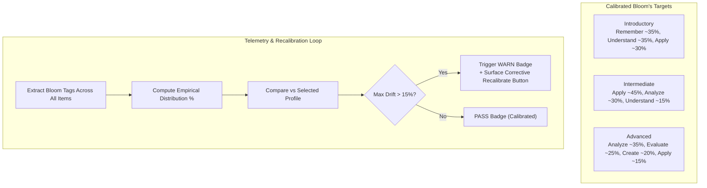
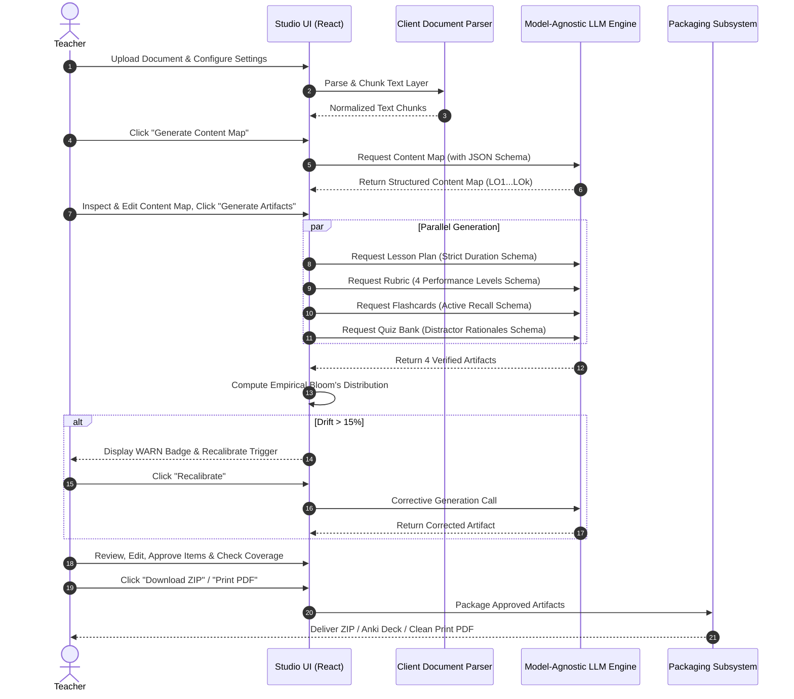

# High-Level System Architecture
## Model-Agnostic Educational Artifact Generator

---

### 1. Conceptual Architecture Diagram

```
+----------------------------------------------------------------------------------------------------+
|                                CLIENT BROWSER RUNTIME (SPA)                                        |
+----------------------------------------------------------------------------------------------------+
|  0. HOME LANDING VIEW & NAVIGATION LAYER                                                           |
|     [Product Introduction] <---> [6-Step Pipeline Guide] <---> [Instant Sample Presets]            |
|     [Persistent State Router: showLanding Toggle | Home/Guide & Workspace Buttons in Header]       |
|                                                                                                    |
|  1. INGESTION & PARSING ENGINE                                                                     |
|     [Drag & Drop / Text Input] ---> [Client-Side PDF/Text Parser] ---> [Heading Chunker / Filter] |
|                                                                                                    |
|  2. PEDAGOGICAL BOUNDARY ENGINE                                                                    |
|     [Teacher Settings: Audience, Duration, Target Difficulty Profile, Language]                    |
|             │                                                                                      |
|             ▼                                                                                      |
|  3. CONTENT MAP SYNTHESIS (Single Source of Truth)                                                 |
|     +---------------------------------------------------------------------------------------+      |
|     | CONTENT MAP (SSOT)                                                                    |      |
|     |  * Indexed Objective Identifiers (LO1, LO2, LO3...)                                    |      |
|     |  * Grounded Key Concepts, Terms & Definitions                                         |      |
|     |  * Explicit Source Section Citations                                                  |      |
|     |  * Target Bloom's Taxonomy Verbs                                                      |      |
|     +---------------------------------------------------------------------------------------+      |
|             │                                                                                      |
|  4. PARALLEL ARTIFACT SYNTHESIS (Strict JSON Schema Mode)                                          |
|     +---------------+   +---------------+   +-------------------+   +--------------------+         |
|     |  Lesson Plan  |   |    Rubric     |   | Active Flashcards |   |     Quiz Bank      |         |
|     |   Generator   |   |   Generator   |   |     Generator     |   |     Generator      |         |
|     +---------------+   +---------------+   +-------------------+   +--------------------+         |
|             │                   │                     │                       │                    |
|  5. BLOOM'S TAXONOMY CALIBRATOR & DRIFT SUBSYSTEM                                                  |
|     [Distribution Aggregator] <---> [Recharts Comparison: Actual vs Target Profile]                |
|     [Drift Detection (>15%)]   ---> [One-Click Targeted Corrective Recalibrate]                    |
|                                                                                                    |
|  6. INSTRUCTOR REVIEW & VERIFICATION LAYER                                                         |
|     * Three-State Approval Controls (Approve / Needs Edit / Reject)                                |
|     * Learning Objective Coverage Matrix (+ Generate Missing Items)                                |
|     * Dynamic Item-Level Calibration ("Make Harder" / "Make Easier")                               |
|     * Telemetry Dashboard (100% JSON Schema Adherence, Citation Rate %, LO Coverage %)             |
|                                                                                                    |
|  7. PACKAGING & EXPORT ENGINE                                                                      |
|     [Export Bundler] ---> ZIP Bundle (Markdown, Anki CSV, package.json, Clean Print PDF)           |
+----------------------------------------------------------------------------------------------------+
                                      │
                        HTTPS (JSON Mode / Structured Outputs)
                                      ▼
+----------------------------------------------------------------------------------------------------+
|                        MODEL-AGNOSTIC LLM INFERENCE PROVIDER                                       |
|          (Any compliant LLM API Endpoint: Cloud, Private Enterprise, or Local)                     |
|                   Schema Enforcement: responseSchema / JSON Mode                                   |
+----------------------------------------------------------------------------------------------------+
```

---

### 2. Architectural Subsystems

#### 2.1 Ingestion & Preprocessing Subsystem
- **Format Support**: Ingests `.pdf`, `.md`, and `.txt` files, alongside a raw text clipboard paste area.
- **Client-Side Extraction**: Extracts text layers using client-side WebAssembly/JavaScript parsers without transferring raw documents to third-party file storage.
- **Empty / Scanned PDF Guard**: Validates character density across pages. If a scanned document lacks machine-readable text layers, the system alerts the user and halts processing rather than transmitting empty buffers.
- **Heading-Aware Hierarchical Chunker**: Analyzes structural markdown headings (`#`, `##`, `Chapter`, `Section`, `Week`). For documents exceeding 1,500 words, chunks are summarized in modular passes to preserve technical definitions and reduce context degradation.

#### 2.2 Content Map (Single Source of Truth) Pattern
Rather than dispatching raw, noisy source text to four independent generation prompts—which typically causes conflicting terminology and unaligned objectives—MindBridge enforces an architectural **Single Source of Truth (SSOT)**:
1. The analysis engine processes the grounded source text once.
2. It generates a structured **Content Map**:
   - High-level curriculum summary & topic cloud.
   - Grounded key concepts with definitions and source section citations.
   - Identified prerequisites.
   - Standardized, indexed Learning Objectives (`LO1`, `LO2`, `LO3`...).
3. The instructor can view, edit, reorder, or add Learning Objectives directly in the UI.
4. **All subsequent artifact generators bind exclusively to this Content Map**, guaranteeing consistent terminology, objective coverage, and citation references.

#### 2.3 Model-Agnostic LLM Inference Engine
The system abstracts all AI interactions through a provider-independent inference wrapper:
- **API Key & Endpoint Configuration**: Supports runtime configuration via environment variables or direct in-browser input, allowing seamless switching between different model endpoints, custom proxies, and provider keys.
- **Structured JSON Mode**: Enforces strict JSON output schemas (`OBJECT`, `ARRAY`, `STRING`, `INTEGER`) for every transaction, eliminating nondeterministic conversational commentary.
- **Resilience & Rate-Limit Handling**:
  - Automatically handles HTTP rate limits (`429`) and transient server errors (`500`, `503`) using randomized exponential backoff.
  - Automatically retries schema validation or parsing failures.
  - Supports model fallback chains to prevent throughput degradation.

#### 2.4 Parallel Artifact Synthesis Engine
Once the Content Map is confirmed, four specialized generators run concurrently in separate async threads:
1. **Lesson Plan Generator**:
   - Synthesizes pedagogical phases (Introduction, Direct Instruction, Guided Application, Formative Checks, Synthesis).
   - Enforces an invariant: the sum of phase durations must strictly equal the teacher's configured class duration.
   - Generates differentiation strategies for struggling and advanced learners.
2. **Assessment Rubric Generator**:
   - Establishes criterion-referenced metrics across exactly 4 performance levels (Exemplary, Proficient, Developing, Beginning).
   - Every criterion explicitly maps to an identified `LO` ID and carries a weight percentage.
3. **Active Retrieval Flashcards Generator**:
   - Produces atomic prompt-and-answer pairs designed for active recall.
   - Tags each card with its Bloom's Taxonomy level, difficulty tier, source section, and mapped `LO` ID.
4. **Quiz Bank Generator**:
   - Generates multiple-choice and short-answer assessment items.
   - For every distractor in multiple-choice questions, provides explicit misconception rationales explaining *why* the incorrect answer is plausible.
   - Maps each question to an `LO` ID and source citation.

#### 2.5 Bloom's Taxonomy Calibrator & Drift Guard
Cognitive depth is governed by calibrated pedagogical profiles:



If empirical drift exceeds 15 percentage points, the engine provides one-click recalibration: it isolates the offending artifact, injects corrective cognitive restructuring directives, and re-synthesizes only that asset while keeping the rest intact.

#### 2.6 Instructor Review & Governance Layer
The platform operates under a strict **Human-in-the-Loop** model:
- **Approval Workflow**: Instructors can tag each item as `Approved`, `Needs Edit`, or `Rejected`, with visual progress telemetry.
- **Learning Objective Coverage Matrix**: Analyzes whether all `LO` IDs are represented across quizzes, flashcards, and rubric criteria. An integrated `+ Generate Missing` trigger produces targeted items for any identified blind spot.
- **Item-Level Cognitive Tuning**: Includes `Make Harder` and `Make Easier` controls that dynamically prompt the LLM to modulate cognitive load on individual questions or cards without disrupting the surrounding artifact.

#### 2.7 Packaging & Export Subsystem
- **ZIP Packaging Engine**: Assembles an integrated, download-ready archive containing:
  - `lesson-plan.md`
  - `rubric.md`
  - `flashcards.md`
  - `flashcards.csv` (Anki-ready formatted: `Front,Back,Tags`)
  - `quiz-bank.md`
  - `package.json` (Full structured metadata and approval statuses)
  - `print.html` (Standalone academic print layout)
- **Approved vs. All Items Filter**: Teachers can toggle whether exports include only approved items or the complete generated set.
- **Clean Print & PDF View**: Custom `@media print` styling strips all application chrome, navigation elements, and interactive widgets, enforcing clean page breaks between major curriculum components.

#### 2.8 Home Landing View & Guided Navigation Subsystem
- **First-Time Orientation**: Upon initial launch, users are greeted with a comprehensive landing view that details the platform mission, the 4 synchronized artifacts, and a 6-step interactive workflow guide.
- **Instant Sample Loaders**: Features 1-click launchers for pre-configured academic datasets (CS 452 Raft vs Paxos Distributed Consensus lecture notes and CS 210 Data Structures & Algorithms syllabus), allowing users to immediately enter the studio without manual document prep.
- **State-Preserving Bidirectional Navigation**: Persistent header controls ("Home / Guide" and "Workspace") and clickable brand logo enable seamless navigation between instructional guidance and active workspace without resetting document data, settings, or generated artifacts.
- **Distraction-Free Workspace Mode**: When inside the landing view, the workflow stepper is cleanly hidden, presenting an engaging product presentation; entering the workspace reveals the full 6-step pipeline.

---

### 3. Data Flow Architecture


