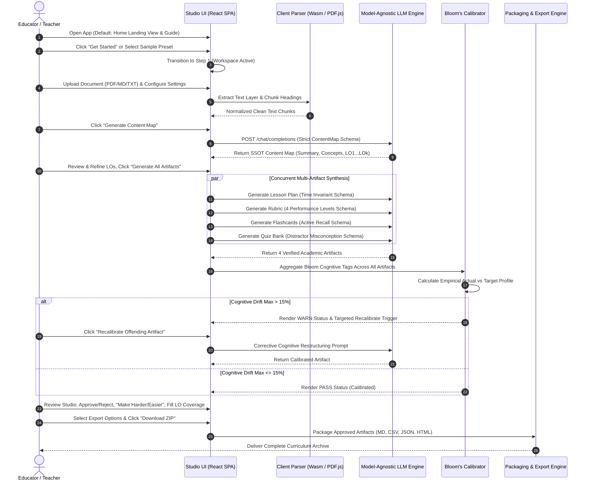

# MindBridge: Academic AI Studio
## Comprehensive Solution Description & System Architecture
**Teaching-Content-to-Review-Ready Artifact Generator**

---

## 1. Executive Summary & Problem Formulation

### 1.1 Executive Summary
**MindBridge** is an academic AI studio engineered to transform unstructured, messy teaching materials—including raw lecture notes, slide outlines, course syllabi, and textbook excerpts—into complete, harmonized, review-ready curriculum packages in under two minutes. 

Operating on a privacy-first, client-side single-page architecture (SPA), MindBridge solves the fundamental flaw of generative educational AI: **cross-artifact hallucination and cognitive drift**. By synthesizing an authoritative, teacher-editable **Single Source of Truth (SSOT) Content Map** first, MindBridge guarantees that its four concurrently generated instructional artifacts—**Time-Budgeted Lesson Plans**, **4-Tier Assessment Rubrics**, **Active Recall Flashcard Decks**, and **Diagnostic Quiz Banks with Distractor Misconception Rationales**—remain perfectly synchronized with zero contradictory objectives or ungrounded grading criteria.

MindBridge integrates a quantitative **Bloom's Taxonomy Calibrator & Drift Guard** that computes empirical cognitive depth distributions against pedagogical difficulty targets, alerting educators if distribution drift exceeds 15% and providing one-click targeted recalibration. With an instructor-in-the-loop review studio, dynamic cognitive modulation ("Make Harder" / "Make Easier"), Learning Objective coverage auditing, and an export engine supporting unified ZIP archives, Anki-compatible CSVs, and academic print styling, MindBridge delivers end-to-end curriculum engineering with mathematical rigor.

### 1.2 Problem Statement
Educators in higher education, secondary schools, and technical bootcamps spend between 5 to 10 hours per lecture module manually translating core academic content into classroom delivery materials:
1. **Instructional Fragmentation**: Creating a lesson plan, an objective-aligned grading rubric, spaced-retrieval flashcards, and diagnostic exam items requires synthesizing disparate documents across disconnected sessions.
2. **Generative Hallucination in Siloed Prompts**: Standard consumer AI chatbots (ChatGPT, Claude, Gemini) generate materials in conversational isolation. When prompted separately for a lesson plan, a rubric, and a quiz, the LLM hallucinates divergent learning objectives, invents evaluation criteria not taught in the lesson, and writes quiz questions that test ungrounded trivia.
3. **Cognitive Drift & Pedagogical Misalignment**: LLMs naturally gravitate toward low-level recall questions or arbitrarily difficult academic jargon without respecting the target cohort's cognitive level according to Bloom's Revised Taxonomy.
4. **Distractor Inadequacy**: Standard automated quiz generators write superficial multiple-choice distractors (e.g., "None of the above" or absurd falsehoods) that provide zero diagnostic value for formative assessment.
5. **Data Privacy & Platform Lock-In**: Many academic institutions prohibit uploading proprietary course notes, unpublished research, or draft exam questions to centralized cloud servers or single-vendor proprietary AI services.

### 1.3 Target Audience
MindBridge is specifically tailored for:
- **University Professors & Lecturers**: Transitioning research notes and textbook chapters into structured undergraduate and graduate lecture modules.
- **Teaching Assistants & Graders**: Generating standardized, transparent, criterion-referenced rubrics with observable grading benchmarks.
- **Instructional Designers & Curriculum Developers**: Aligning institutional course catalogs with standardized accreditation frameworks and Bloom's cognitive taxonomy.
- **Secondary & High School Educators (AP / IB / STEM)**: Designing time-constrained classroom activities and formative assessments.
- **Bootcamp Instructors & Technical Trainers**: Rapidly developing modular curricula for rapid-pace software engineering, cloud, and data science courses.

### 1.4 Core Value Propositions
- **Single Source of Truth (SSOT) Zero-Hallucination Guarantee**: All four artifacts are bound strictly to an intermediate, instructor-editable Content Map (`LO1`, `LO2`, `LO3`...).
- **Calibrated Cognitive Depth (Bloom's Taxonomy)**: Three calibrated profiles (Introductory, Intermediate, Advanced) backed by an empirical $\le 15\%$ drift threshold and 1-click recalibration.
- **Teacher-in-the-Loop Governance**: Granular 3-state item approvals (`Approved`, `Needs Edit`, `Rejected`), item-level difficulty modulation, and an automated Learning Objective Coverage Matrix.
- **Universal Model-Agnostic LLM Engine**: Native support for Google Gemini, OpenAI (GPT-4o), Anthropic Claude, Groq, DeepSeek, OpenRouter, and local models (Ollama, LM Studio) via runtime configuration and standard JSON Schema translation.
- **Zero-Storage Client-Side Privacy**: 100% of PDF extraction and document parsing executes in the user's browser runtime; raw files are never stored on third-party backend databases.

---

## 2. Comprehensive Solution Description & Feature Capabilities

MindBridge provides an end-to-end studio interface organized into an introductory landing view and a 6-step guided curriculum generation pipeline:

```
[Home Landing View & Guide] 
         │
         ▼
[Step 1: Upload & Parse] ──► [Step 2: Teacher Settings] ──► [Step 3: Content Map (SSOT)]
                                                                     │
[Step 6: Packaging & Export] ◄── [Step 5: Review & Calibrate] ◄── [Step 4: Parallel Generation]
```

### 2.1 Home Landing View & Guided Onboarding
When users first access MindBridge, they are greeted by a comprehensive **Home Landing View** that outlines the studio's capabilities and guides them through the curriculum generation workflow:
- **Hero Presentation**: Features the platform badge (*Academic AI Studio • Bloom's Taxonomy Calibrated • Model-Agnostic*), a clear mission headline, and a prominent primary CTA button (**"Get Started in Studio"**).
- **Instant 1-Click Sample Launchers**: Allows educators to instantly experience the full pipeline using preloaded academic datasets:
  - *Distributed Consensus (Raft vs Paxos)*: CS 452 lecture notes covering FLP impossibility, leader election, log replication, split-brain mitigation, and quorum invariants.
  - *CS 210 Data Structures & Algorithms*: Full undergraduate syllabus covering asymptotic analysis, trees, graphs, hashing, sorting, and modular CLOs.
- **The 4 Synchronized Artifacts Showcase**: Visual feature cards detailing the exact pedagogical components of the Lesson Plan, Rubric, Flashcards, and Quiz Bank.
- **6-Step Interactive Workflow Guide**: Numbered cards explaining document ingestion, pedagogical configuration, SSOT synthesis, parallel generation, Bloom calibration, and multi-format export.
- **Core Architectural Highlights Grid**: Technical cards explaining the SSOT zero-hallucination pattern, Bloom's drift guard, human-in-the-loop governance, and universal LLM compatibility.
- **State-Preserving Persistent Navigation**: A top navigation bar with **"Home / Guide"** and **"Workspace"** buttons, plus a clickable brand logo, allowing users to return to the landing guide at any point without losing uploaded documents, teacher settings, or generated artifacts.

### 2.2 Subsystem 1: Document Ingestion & Preprocessing
The ingestion engine accepts unstructured educational inputs across three modalities:
- **Client-Side PDF Text Extraction**: Uses `pdfjs-dist` to extract digital text layers directly inside the browser using WebAssembly.
- **Scanned & Empty Document Guard**: Inspects page character density. If a user uploads an empty or scanned image PDF lacking machine-readable text layers (<20 characters), the system halts processing and provides an immediate warning rather than sending empty buffers to the AI.
- **Markdown & Plaintext Support**: Direct upload of `.md` or `.txt` lecture notes, or direct paste into an interactive text editor.
- **Heading-Aware Hierarchical Chunker**: Analyzes structural Markdown headings (`#`, `##`, `Chapter`, `Section`, `Week`). For documents exceeding 1,500 words, chunks are summarized in modular passes to preserve technical definitions without context window degradation.

### 2.3 Subsystem 2: Pedagogical Boundary Configuration
Instructors establish explicit educational constraints that govern downstream artifact synthesis:
- **Target Audience Profile**: From introductory high school / freshman courses to advanced graduate seminars and professional engineering teams.
- **Classroom Duration Constraint (15–240 minutes)**: Establishes a mathematical invariant for the lesson plan timeline.
- **Bloom's Target Difficulty Profiles**:
  - *Introductory Profile*: 35% Remember, 35% Understand, 30% Apply (high scaffolding, plain vocabulary, worked examples).
  - *Intermediate Profile*: 10% Remember, 15% Understand, 45% Apply, 30% Analyze (medium scaffolding, diagnostic problem-solving, trade-offs).
  - *Advanced Profile*: 5% Understand, 15% Apply, 35% Analyze, 25% Evaluate, 20% Create (minimal scaffolding, adversarial failure modes, open-ended architectural design).
- **Assessment Volume Controls**: Configurable flashcard counts (5–30 cards) and quiz item counts (4–20 questions).

### 2.4 Subsystem 3: Content Map (Single Source of Truth) Pattern
Rather than feeding raw source text into independent prompts, MindBridge enforces an architectural Single Source of Truth:
1. The model-agnostic engine analyzes the source text once and synthesizes a structured **Content Map**:
   - Executive curriculum summary and detected document classification.
   - Core topic hierarchy and prerequisites.
   - Grounded key concepts with precise definitions and source section citations.
   - Indexed Learning Objectives (`LO1`, `LO2`, `LO3`...) with active Bloom's taxonomy verbs and source citations.
2. **Teacher-Editable Inspection Interface**: Instructors can review the Content Map in an interactive table, modify Bloom verb classifications, adjust objective descriptions, add custom LOs, or remove irrelevant topics before generating artifacts.
3. **Downstream Schema Invariant**: All subsequent artifact generators receive this confirmed Content Map as an immutable boundary. Every generated quiz item, rubric criterion, and flashcard must explicitly link to an identified `LO` ID.

### 2.5 Subsystem 4: Parallel Multi-Artifact Synthesis
Once the Content Map is confirmed, MindBridge launches four concurrent async generation tasks:
1. **Lesson Plan Generator**:
   - Synthesizes a structured timeline divided into pedagogical phases: Introduction / Hook, Direct Instruction, Guided Application, Formative Checks, and Synthesis / Wrap-up.
   - Strictly enforces the time-budget invariant: $\sum \text{phase\_duration} = \text{configured\_class\_duration}$.
   - Provides explicit teacher actions, student actions, formative assessment checks, and differentiation strategies for struggling vs. advanced learners.
2. **Assessment Rubric Generator**:
   - Produces a criterion-referenced rubric across exactly four performance tiers: Exemplary, Proficient, Developing, and Beginning.
   - Replaces vague adjectives (e.g., "good understanding") with concrete, observable student behaviors.
   - Assigns percentage weights to each criterion, mapping each directly to an `LO` ID.
3. **Active Recall Flashcards Generator**:
   - Generates atomic prompt-and-answer pairs designed for retrieval practice.
   - Tags every card with its Bloom's Taxonomy cognitive level, difficulty tier, source section citation, and mapped `LO` ID.
   - Pre-formatted for seamless Anki CSV import (`Front,Back,Tags`).
4. **Diagnostic Quiz Bank Generator**:
   - Creates a balanced distribution of multiple-choice questions (MCQs) and short-answer diagnostic items.
   - **Distractor Misconception Rationales**: For every incorrect MCQ option, the engine provides an explicit rationale explaining the cognitive fallacy or student misunderstanding being probed.
   - Maps each question to an `LO` ID and source section citation.

### 2.6 Subsystem 5: Bloom's Taxonomy Calibrator & Drift Guard
MindBridge features a quantitative cognitive calibration engine:
- **Empirical Tag Extraction**: Scans all generated items (rubric criteria, flashcards, quiz questions, lesson plan phases) and extracts their cognitive Bloom levels.
- **Empirical Distribution Calculation**: Computes the percentage distribution across the six cognitive levels: Remember, Understand, Apply, Analyze, Evaluate, Create.
- **Drift Formula**: Computes cognitive drift $\Delta_i$ for each Bloom level:
  $$\Delta_i = |A_i - T_i|$$
  where $A_i$ is the empirical actual percentage and $T_i$ is the configured target percentage.
- **15% Drift Guard Threshold**:
  - If $\max_i(\Delta_i) \le 15\%$, the studio displays a green **PASS** badge indicating cognitive calibration.
  - If $\max_i(\Delta_i) > 15\%$, the studio displays an amber **WARN** badge and alerts the instructor.
- **1-Click Targeted Recalibration**: Rather than re-running the entire pipeline, the engine identifies the artifact contributing most to cognitive drift, injects targeted cognitive restructuring instructions into the prompt, and regenerates only that artifact.

### 2.7 Subsystem 6: Human-in-the-Loop Review Studio
The Review Studio empowers educators to audit and refine generated assets:
- **Dedicated Tabbed Workspace**: Seamless switching between Lesson Plan, Assessment Rubric, Flashcards, Quiz Bank, Learning Objective Coverage Matrix, and Telemetry Dashboard.
- **Three-State Item Approvals**: Educators can tag every single question, card, or rubric row as `Approved`, `Needs Edit`, or `Rejected`.
- **Dynamic Cognitive Tuning ("Make Harder" / "Make Easier")**: Instructors can click "Make Harder" or "Make Easier" on individual quiz items or flashcards. The engine dynamically prompts the LLM to elevate or scaffold cognitive demand for that item in-place without altering the surrounding artifact.
- **Learning Objective Coverage Matrix**: Audits representation of every `LO` across the four artifacts. If an objective lacks sufficient coverage (e.g., `LO3` has a flashcard but no quiz question), a `+ Generate Missing` trigger prompts the LLM to synthesize an item specifically addressing that blind spot.
- **Quality Telemetry Dashboard**: Real-time display of JSON schema validity rate (100%), source citation rate %, LO coverage %, and Bloom alignment score.

### 2.8 Subsystem 7: Packaging & Multi-Format Export Suite
MindBridge packages verified curriculum materials into multiple industry-standard formats:
- **Unified ZIP Archive**: Downloads a structured `.zip` containing:
  - `lesson-plan.md`: Formatted Markdown with timeline tables, teacher/student actions, and differentiation notes.
  - `rubric.md`: Complete Markdown rubric table with percentage weights and performance descriptors.
  - `flashcards.md`: Markdown-formatted flashcard collection.
  - `flashcards.csv`: Pre-formatted Anki import file (`Front,Back,Tags`).
  - `quiz-bank.md`: Formatted quiz items with answer keys and distractor misconception explanations.
  - `package.json`: Complete machine-readable curriculum package containing all raw JSON data, teacher settings, and approval statuses.
  - `print.html`: Standalone, self-contained academic HTML document ready for browser rendering.
- **Approved vs. All Filter**: Instructors can export all items or restrict exports exclusively to items marked `Approved`.
- **Clean Academic Print Engine**: Custom `@media print` CSS engine strips navigation bars, buttons, and UI chrome, applying page-break constraints (`break-inside-avoid`, clean margins) for print-ready syllabus packets.

---

## 3. System Architecture & Subsystem Specifications

### 3.1 High-Level Conceptual Architecture Diagram

```
+----------------------------------------------------------------------------------------------------+
|                                CLIENT BROWSER RUNTIME (SPA)                                        |
+----------------------------------------------------------------------------------------------------+
|  0. HOME LANDING VIEW & NAVIGATION LAYER                                                           |
|     [Product Introduction] <---> [6-Step Pipeline Guide] <---> [Instant Sample Presets]            |
|     [Persistent State Router: showLanding Toggle | Home/Guide & Workspace Buttons in Header]       |
|                                                                                                    |
|  1. INGESTION & PARSING ENGINE                                                                     |
|     [Drag & Drop / Text Input] ---> [Client-Side PDF/Text Parser] ---> [Heading Chunker / Filter] |
|                                                                                                    |
|  2. PEDAGOGICAL BOUNDARY ENGINE                                                                    |
|     [Teacher Settings: Audience, Duration, Target Difficulty Profile, Language]                    |
|             │                                                                                      |
|             ▼                                                                                      |
|  3. CONTENT MAP SYNTHESIS (Single Source of Truth)                                                 |
|     +---------------------------------------------------------------------------------------+      |
|     | CONTENT MAP (SSOT)                                                                    |      |
|     |  * Indexed Objective Identifiers (LO1, LO2, LO3...)                                    |      |
|     |  * Grounded Key Concepts, Terms & Definitions                                         |      |
|     |  * Explicit Source Section Citations                                                  |      |
|     |  * Target Bloom's Taxonomy Verbs                                                      |      |
|     +---------------------------------------------------------------------------------------+      |
|             │                                                                                      |
|  4. PARALLEL ARTIFACT SYNTHESIS (Strict JSON Schema Mode)                                          |
|     +---------------+   +---------------+   +-------------------+   +--------------------+         |
|     |  Lesson Plan  |   |    Rubric     |   | Active Flashcards |   |     Quiz Bank      |         |
|     |   Generator   |   |   Generator   |   |     Generator     |   |     Generator      |         |
|     +---------------+   +---------------+   +-------------------+   +--------------------+         |
|             │                   │                     │                       │                    |
|  5. BLOOM'S TAXONOMY CALIBRATOR & DRIFT SUBSYSTEM                                                  |
|     [Distribution Aggregator] <---> [Recharts Comparison: Actual vs Target Profile]                |
|     [Drift Detection (>15%)]   ---> [One-Click Targeted Corrective Recalibrate]                    |
|                                                                                                    |
|  6. INSTRUCTOR REVIEW & VERIFICATION LAYER                                                         |
|     * Three-State Approval Controls (Approve / Needs Edit / Reject)                                |
|     * Learning Objective Coverage Matrix (+ Generate Missing Items)                                |
|     * Dynamic Item-Level Calibration ("Make Harder" / "Make Easier")                               |
|     * Telemetry Dashboard (100% JSON Schema Adherence, Citation Rate %, LO Coverage %)             |
|                                                                                                    |
|  7. PACKAGING & EXPORT ENGINE                                                                      |
|     [Export Bundler] ---> ZIP Bundle (Markdown, Anki CSV, package.json, Clean Print PDF)           |
+----------------------------------------------------------------------------------------------------+
                                      │
                        HTTPS (JSON Mode / Structured Outputs)
                                      ▼
+----------------------------------------------------------------------------------------------------+
|                        MODEL-AGNOSTIC LLM INFERENCE PROVIDER                                       |
|          (Google Gemini, OpenAI, Anthropic Claude, Groq, DeepSeek, Local Ollama / LM Studio)       |
|                   Schema Enforcement: responseSchema / JSON Mode                                   |
+----------------------------------------------------------------------------------------------------+
```

### 3.2 Model-Agnostic LLM Inference Engine & Schema Translation
MindBridge does not bind the educator to a single proprietary AI provider. It features a universal inference adapter (`src/services/geminiService.js`):
- **Universal Provider Adapter**: Interfaces seamlessly with:
  - Google Gemini (`gemini-1.5-flash`, `gemini-1.5-pro`, `gemini-2.0-flash-exp`)
  - OpenAI (`gpt-4o`, `gpt-4o-mini`)
  - Anthropic Claude (`claude-3-5-sonnet`, `claude-3-haiku` via compatible proxies)
  - Groq (`llama-3.3-70b-versatile`, `mixtral-8x7b-32768`)
  - OpenRouter & DeepSeek (`deepseek-chat`, `deepseek-reasoner`)
  - Local Offline Inference: Ollama (`http://localhost:11434/v1`) and LM Studio (`http://localhost:1234/v1`).
- **Dynamic Schema Normalizer**: Translates uppercase Gemini schema format (`OBJECT`, `STRING`, `ARRAY`, `INTEGER`) into standard OpenAPI 3.0 / JSON Schema specifications expected by OpenAI and Ollama endpoints on the fly.
- **Enterprise Resilience**: Includes automatic exponential backoff retry for HTTP `429` (rate limit) and `503` (service unavailable) responses, along with automatic single retry for JSON parsing anomalies.

### 3.3 End-to-End Data Flow Sequence Diagram



---

## 4. Mathematical & Pedagogical Formulations

### 4.1 Bloom's Revised Taxonomy Cognitive Framework
MindBridge models cognitive depth according to Bloom's Revised Taxonomy (Anderson & Krathwohl, 2001), representing the cognitive process dimension across six hierarchical tiers:
1. **$C_1$: Remember**: Retrieving relevant knowledge from long-term memory (recognizing, recalling facts, terms, basic concepts).
2. **$C_2$: Understand**: Constructing meaning from instructional messages (interpreting, exemplifying, classifying, summarizing, inferring, comparing, explaining).
3. **$C_3$: Apply**: Carrying out or using a procedure in a given situation (executing, implementing formulas, calculating, solving).
4. **$C_4$: Analyze**: Breaking material into constituent parts and determining how parts relate to one another and an overall structure (differentiating, organizing, attributing, diagnosing failure modes).
5. **$C_5$: Evaluate**: Making judgments based on criteria and standards (checking, critiquing, defending, assessing trade-offs, judging validity).
6. **$C_6$: Create**: Putting elements together to form a novel, coherent whole or make an original product (generating hypotheses, planning experiments, designing architectures).

### 4.2 Calibrated Pedagogical Difficulty Target Matrices
The target distribution vector $\mathbf{T} = [T_1, T_2, T_3, T_4, T_5, T_6]^T$ satisfies the simplex constraint $\sum_{i=1}^6 T_i = 100\%$:

| Cognitive Level ($C_i$) | Introductory Profile ($\mathbf{T}_{intro}$) | Intermediate Profile ($\mathbf{T}_{inter}$) | Advanced Profile ($\mathbf{T}_{adv}$) |
| :--- | :---: | :---: | :---: |
| **Remember** ($C_1$) | $35\%$ | $10\%$ | $0\%$ |
| **Understand** ($C_2$) | $35\%$ | $15\%$ | $5\%$ |
| **Apply** ($C_3$) | $30\%$ | $45\%$ | $15\%$ |
| **Analyze** ($C_4$) | $0\%$ | $30\%$ | $35\%$ |
| **Evaluate** ($C_5$) | $0\%$ | $0\%$ | $25\%$ |
| **Create** ($C_6$) | $0\%$ | $0\%$ | $20\%$ |
| **Sum ($\sum T_i$)** | **$100\%$** | **$100\%$** | **$100\%$** |

### 4.3 Empirical Distribution & Drift Metric
Let $N$ denote the total number of cognitive-tagged items synthesized across all four artifacts (lesson plan phases, rubric criteria, flashcards, and quiz items). Let $n_i$ represent the number of items classified under cognitive level $C_i$.

The empirical actual distribution vector $\mathbf{A} = [A_1, A_2, A_3, A_4, A_5, A_6]^T$ is computed as:
$$A_i = \left( \frac{n_i}{N} \right) \times 100\%$$

The absolute cognitive drift $\Delta_i$ for each tier $i \in \{1, \dots, 6\}$ is:
$$\Delta_i = |A_i - T_i|$$

The **Maximum Cognitive Drift** $\Delta_{\max}$ governing system telemetry is defined as:
$$\Delta_{\max} = \max_{i \in \{1, \dots, 6\}} |A_i - T_i|$$

### 4.4 The 15% Drift Threshold & Targeted Cognitive Recalibration
MindBridge establishes an empirical decision boundary for cognitive fidelity:
$$\text{Status}(\Delta_{\max}) = \begin{cases} \text{PASS (Calibrated)}, & \Delta_{\max} \le 15\% \\ \text{WARN (Drift Alert)}, & \Delta_{\max} > 15\% \end{cases}$$

When $\Delta_{\max} > 15\%$, the calibrator isolates the artifact index $k^*$ exhibiting the highest skew relative to target $\mathbf{T}$:
$$k^* = \arg\max_k D_{artifact}(k, \mathbf{T})$$
A corrective prompt injects restorative cognitive constraints (e.g., *"Elevate from Remember/Understand to Apply/Analyze: convert definitional questions into diagnostic failure scenarios"*), recalibrating only artifact $k^*$ to bring $\Delta_{\max} \le 15\%$ while preserving all other approved assets.

---

## 5. User Guide, Walkthrough & Sample Presets

### 5.1 Step-by-Step Instructor Walkthrough

```
[1. Upload & Parse] ──► [2. Teacher Settings] ──► [3. Content Map] ──► [4. Generate] ──► [5. Review Studio] ──► [6. Export Package]
```

#### Step 0: Exploration & Landing Orientation
- Launch MindBridge. The application defaults directly to the **Home Landing View**.
- Read the feature overview and review the 6-step workflow.
- Click **"Get Started in Studio"** to enter the workspace, or click one of the instant sample preset buttons to load sample lecture notes immediately.

#### Step 1: Upload & Ingestion
- In the workspace, either drag-and-drop a `.pdf`, `.md`, or `.txt` file, or paste raw notes into the text area.
- Verify that character counts and word counts update in real-time.
- If a document exceeds 1,500 words, note the automatic heading-aware chunking telemetry.
- Click **"Proceed to Teacher Settings"**.

#### Step 2: Teacher Settings Configuration
- Select target audience (e.g., *Undergraduate Computer Science*).
- Set instructional duration (e.g., *50 minutes*).
- Select the Target Difficulty Profile:
  - Choose *Introductory* for freshman/foundational topics.
  - Choose *Intermediate* for core engineering and application topics.
  - Choose *Advanced* for senior capstone and graduate seminars.
- Set desired quiz question count (e.g., 8) and flashcard count (e.g., 10).
- Click **"Generate Content Map"**.

#### Step 3: Content Map (SSOT) Inspection & Editing
- Review the synthesized Content Map table: topics, prerequisites, key concepts with source citations, and indexed Learning Objectives (`LO1`, `LO2`, `LO3`...).
- Modify descriptions, reclassify Bloom verbs, or click **"+ Add Learning Objective"** to introduce custom instructor goals.
- Click **"Confirm Content Map & Run All Generators"**.

#### Step 4: Parallel Multi-Artifact Generation
- Watch live status indicators as the Lesson Plan, Rubric, Flashcards, and Quiz Bank synthesize concurrently in parallel.
- Once all four progress bars reach 100% completion, click **"Proceed to Review Studio"**.

#### Step 5: Review Studio, Bloom Calibration & Governance
- Inspect the **Bloom's Taxonomy Calibrator**:
  - Review the Recharts bar chart comparing actual item percentages against target profile percentages.
  - If a **WARN** badge appears ($\Delta_{\max} > 15\%$), click **"Recalibrate Artifact"** to execute a targeted cognitive correction.
- Switch between artifact tabs:
  - *Lesson Plan*: Verify that the phased timeline sums strictly to your configured duration (50 min).
  - *Assessment Rubric*: Review the 4-tier grading descriptors and objective percentage weights.
  - *Flashcards*: Test active recall cards and inspect Bloom tags.
  - *Quiz Bank*: Verify multiple-choice questions and read the distractor misconception rationales.
- Tune individual items:
  - Click **"Make Harder"** or **"Make Easier"** on any question or card to modulate its cognitive level in real-time.
  - Mark items as `Approved`, `Needs Edit`, or `Rejected`.
- Inspect the **Learning Objective Coverage Matrix**:
  - Verify that all `LO` IDs are adequately covered across quizzes, cards, and rubric criteria.
  - Click **"+ Generate Missing"** on any under-represented objective to synthesize targeted items.
- Click **"Proceed to Export Package"**.

#### Step 6: Multi-Format Packaging & Export
- Toggle export scope: *All Items* or *Approved Items Only*.
- Click **"Download ZIP Package"** to receive the complete bundle (`lesson-plan.md`, `rubric.md`, `flashcards.md`, `flashcards.csv`, `quiz-bank.md`, `package.json`, `print.html`).
- Click **"Print / Save PDF"** to open the clean academic print view and print directly to PDF or paper with zero application chrome.

### 5.2 2-Minute Demo Script

| Elapsed Time | Action | Screen / View | Expected Result |
| :---: | :--- | :--- | :--- |
| **0:00 - 0:15** | Open application; view Home Landing View; click **"Try Raft vs Paxos Sample"**. | Home Landing View $\to$ Step 1 | Workspace opens directly with CS 452 Distributed Consensus notes preloaded. |
| **0:15 - 0:30** | Click **"Proceed to Teacher Settings"**; leave defaults (Intermediate, 50 min, CS undergrad); click **"Generate Content Map"**. | Step 2 $\to$ Step 3 | Content Map synthesizes in ~8 seconds with 5 indexed LOs (`LO1`–`LO5`). |
| **0:30 - 0:45** | Verify `LO1` (Leader Election), `LO2` (Log Replication), `LO3` (Split-Brain Mitigation); click **"Run All Generators"**. | Step 3 $\to$ Step 4 | Live parallel progress cards display concurrent synthesis across all 4 artifacts. |
| **0:45 - 1:15** | Generators complete; click **"Proceed to Review Studio"**; inspect Bloom chart (PASS badge); review Lesson Plan 50-minute timeline. | Step 5 (Review Studio) | Timeline sums to exactly 50 min; MCQ distractors show explicit cognitive misconception rationales. |
| **1:15 - 1:40** | Click **"Make Harder"** on Quiz Question 2; observe in-place elevation to architectural edge case; approve items. | Step 5 (Review Studio) | Item updates dynamically with higher Bloom tier; approval counter increments. |
| **1:40 - 2:00** | Click **"Proceed to Export Package"**; click **"Download ZIP Package"**; inspect downloaded `.zip` archive. | Step 6 (Export Panel) | ZIP bundle containing Markdown, Anki CSV, package.json, and standalone Print HTML downloads instantly. |

---

## 6. Technical Specifications, Technology Stack & Build Verification

### 6.1 Technology Stack & Architectural Dependencies

| Layer | Technology | Version | Architectural Responsibility |
| :--- | :--- | :---: | :--- |
| **Runtime Environment** | Node.js | $\ge 18.0$ | Build execution, document generation scripts, asset bundling |
| **Application Framework** | React | `18.3.1` | Reactive component tree, SPA state orchestration |
| **Build & Bundler** | Vite | `5.4.14` | Ultra-fast ES module dev server, production Rollup bundling |
| **CSS & Design System** | Tailwind CSS | `3.4.17` | Utility-first responsive design, custom `@media print` rules |
| **Iconography** | Lucide React | `0.475.0` | Comprehensive semantic SVG iconography |
| **Data Visualization** | Recharts | `2.15.1` | Declarative, responsive Bloom's actual vs target bar charts |
| **PDF Extraction** | pdfjs-dist | `3.11.174` | Client-side WebAssembly PDF digital text parsing |
| **Document Generation** | docx | `9.15.4` | Server/script generation of Microsoft Word submission docs |
| **PDF Generation** | pdfkit | `0.20.2` | Clean script generation of vector PDF submission docs |
| **Archive Packaging** | JSZip & FileSaver | `3.10.1` / `2.0.5` | In-browser multi-file ZIP compilation and instant client download |

### 6.2 Workspace State & Routing Architecture
- **In-Memory State Preservation**: All core session data (`currentStep`, `documentTitle`, `documentText`, `teacherSettings`, `contentMap`, `lessonPlan`, `rubric`, `flashcards`, `quizBank`, `approvals`) is centrally maintained in the root `App.jsx` React component state.
- **State-Preserving Landing Router**: View switching is governed by the `showLanding` boolean state. Navigating between the Home Landing View and the generation workspace via the header controls or brand logo never unmounts or resets session state.
- **Zero Third-Party Storage**: No user documents, notes, or generated quizzes are sent to or stored on external cloud databases. Processing occurs entirely in-memory within the client browser.

### 6.3 Build & Verification Instructions
To independently verify the application build and document generation from source:

1. **Clone & Install Dependencies**:
   ```powershell
   git clone <repository-url>
   cd hackathon
   npm install
   ```

2. **Verify Production Bundle Build**:
   ```powershell
   npm run build
   ```
   *Expected Output*: Vite builds all 2,215 modules into `dist/` with exit code `0`.

3. **Generate Submission Documentation (Markdown, DOCX, PDF)**:
   ```powershell
   node scripts/generate_submission_docs.cjs
   ```
   *Expected Output*: Compiles `SOLUTION_DESCRIPTION.md` into `SOLUTION_DESCRIPTION.docx` and `SOLUTION_DESCRIPTION.pdf` matching repository formatting.

4. **Launch Local Development Server**:
   ```powershell
   npm run dev
   ```
   *Expected Output*: Vite dev server starts at `http://localhost:5173/`, displaying the Home Landing View by default.
